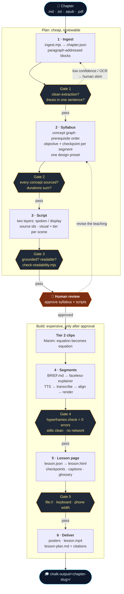
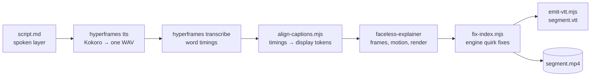

<div align="center">


**Turn a book chapter into minimal animated lessons.**

The board, the diagram, and the voice that walks you through, with every line traceable to the page it came from.


</div>

---

## What it does

Point `/chalk` at a chapter. It reads it, works out the order the ideas actually need to be taught in
(which is rarely page order), and produces a short lesson series:

- an **MP4 per segment**, narrated and minimally animated
- an interactive **`lesson.html`** that plays the segments in order and stops at a **checkpoint question** between each
- a **`lesson-plan.md`** with a source citation for every claim

| | |
|---|---|
| **Grounded** | Every narration line and on-screen word maps to paragraph ids in the source. No invented numbers, dates or examples. |
| **Honest about maths** | An equation the extractor can't read cleanly is never rendered. You get the cropped source or a question. |
| **Audio is the clock** | Scene timing comes from the voiceover's word timings, so captions and cuts never drift. |
| **Reviewed before rendered** | The pipeline stops after planning so you fix the teaching in two minutes, not after a thirty-minute render. |
| **One look** | A single dark, high-contrast, line-drawn design preset for the whole series. |

## How it works

chalk owns the **pedagogy** (what to teach, in what order, grounded in which paragraphs). The video
itself is built by [Hyperframes](https://github.com/heygen-com/hyperframes) and its
`faceless-explainer` skill. Each step ends in a gate, and a failing gate stops the run.

### Agent flow



### Inside step 4: the audio is the clock



A frame's duration equals its narration, exactly. Regenerating the voiceover invalidates every
downstream timing, so it is a hard reset, not a tweak.

### Tier routing, per scene

| Tier | Used for | Why |
|---|---|---|
| **1 · HTML/SVG + KaTeX** | Concepts, diagrams, charts, displayed equations | The default. Interactive, restylable, no LaTeX toolchain. |
| **2 · Manim** | An equation that must *become* another; geometric construction, limits, fields | Earned by the scene, never chosen by default. It renders to flat video. |
| **3 · The book's own figure** | When the original figure is already the clearest visual | Don't redraw what is already good. |

## Status

Every step has a working implementation. The pipeline pauses at the step-3 review gate by design.

| Step | State |
|---|---|
| Ingest | `.md`, `.txt`, `.epub`, `.pdf`, including scanned PDFs via OCR |
| Syllabus, script | Grounding and readability gates enforced |
| Segments | Delegated to `faceless-explainer`; Tier 2 Manim renders and composites |
| Lesson page | Checkpoints, captions, glossary, progress, keyboard |
| Deliver | Settled-frame posters, `lesson.mp4`, `lesson-plan.md` with citation table |

**Known rough edges:** PDF figures are not extracted, and an equation hands over its whole rendered
page rather than a crop of the region.

## Quick start

### Requirements

- Node ≥ 22, FFmpeg, Chrome. Check with `npx hyperframes doctor`.
- `whisper-cpp`, which supplies the word timings.
- Optional, for maths: `manim`, plus TinyTeX or BasicTeX for `MathTex` (see [manim.md](skills/chalk/references/manim.md)).
- For PDFs: `pdftotext` (poppler); `tesseract` as well for scanned pages.

### Install

```bash
git clone https://github.com/OlixIgnacious/chalk.git
cd chalk
npx hyperframes doctor     # environment gate
npx hyperframes skills     # installs faceless-explainer + the hyperframes domain skills

# Kokoro TTS is not bundled, and it needs its own interpreter (see below)
brew install python@3.12
uv venv --python 3.12 .venv
uv pip install --python .venv/bin/python kokoro-onnx soundfile
export HYPERFRAMES_PYTHON="$PWD/.venv/bin/python"
```

<details>
<summary><b>Why a separate Python interpreter?</b></summary>

`kokoro-onnx` needs Python `>=3.10,<3.14`, and the `python3` macOS ships at `/usr/bin/python3` is
3.9. That one cannot be upgraded, because it is part of the OS and macOS tooling depends on it. The
fix is a newer interpreter alongside it, which is what the venv is. If you already have a Homebrew
Python in range, point `HYPERFRAMES_PYTHON` straight at it and skip the venv.

Put `HYPERFRAMES_PYTHON` in your shell profile. Without it, voiceover fails at step 4, after all the
planning work is done.
</details>

Open the repo in Claude Code and the `chalk` skill is discovered automatically. To use it elsewhere,
symlink `skills/chalk` into `~/.claude/skills/`.

### Use

```bash
/chalk fixtures/gutenberg-chapter.md
/chalk book.epub --chapter 4 --segments 5
/chalk stats.pdf --chapter "Sampling" --math on
/chalk this chapter, but assume they've never seen calculus
```

A book with several chapters and no `--chapter` prints its splits and stops rather than guessing
which one you meant.

| Option | Values | Default |
|---|---|---|
| `--chapter` | number or title | asked for, when the input holds several |
| `--segments` | 3–6 | inferred from length |
| `--format` | `landscape`, `vertical`, `square` | `landscape` |
| `--audience` | freeform, e.g. "first-year undergrads" | inferred |
| `--math` | `auto`, `on`, `off` | `auto` |
| `--draft` | flag, renders at 720p | full resolution |

## Output

The segment MP4s come from step 4; everything else is written by the scripts in this repo.

```
chalk-output/<chapter-slug>/
├── lesson.html          interactive: segment nav, checkpoints, captions, glossary
├── lesson.mp4           all segments concatenated
├── lesson.json          the manifest the player reads
├── lesson-plan.md       syllabus, objectives, and a source citation per claim
└── segments/NN/
    ├── segment.mp4
    ├── segment.vtt
    └── script.md
```

If the folder already exists, the run goes to a timestamped sibling instead of overwriting it.

## Repository layout

```
skills/chalk/
├── SKILL.md             thin entry point and the six gates
├── references/          one step-N-*.md per step, loaded only when that step runs
├── scripts/             ingest, build-tokens, align-captions, emit-vtt, fix-index,
│                        manim-render, build-lesson-page, deliver, check-readability
└── assets/
fixtures/                public-domain Project Gutenberg test inputs
test/                    smoke, player-browser and tier2 gates
```

This repo is mostly Markdown and reference data, not an application. The scripts exist only where
nothing upstream covers the job. Read [CLAUDE.md](CLAUDE.md) before changing anything under
`skills/chalk/`.

## Testing

Tests run against `fixtures/` (public-domain text). Never test against a copyrighted book.

```bash
npm test              # the script regression gate
npm run test:player   # the lesson page, driven in Chrome
npm run test:tier2    # the Manim render and its alpha compositing
npx hyperframes doctor
```

## Credits and licence

Video engine: [Hyperframes](https://github.com/heygen-com/hyperframes) by HeyGen (Apache-2.0).
`align-captions.mjs` is vendored from it; see [CREDITS.md](CREDITS.md).

Apache-2.0. See [LICENSE](LICENSE).
