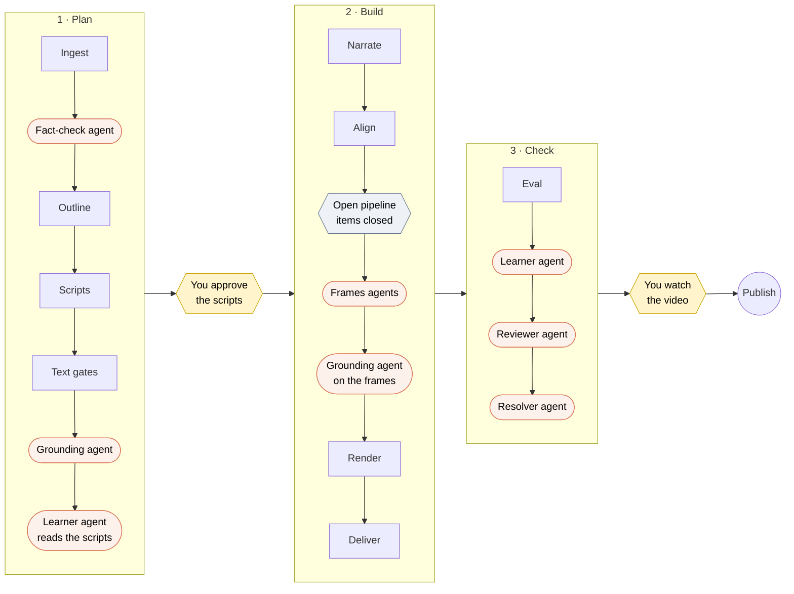

<div align="center">


**Turn a source document into grounded teaching: a YouTube video, an interactive lesson, a Short, and a notebook. Every line traces back to the source.**

[](LICENSE)
[](https://nodejs.org)
[](https://github.com/heygen-com/hyperframes)
[](https://claude.com/claude-code)

[Overview](#overview) · [Formats](#formats) · [Agent flow](#agent-flow) · [Quick start](#quick-start) · [CLI](#cli-reference) · [Evaluation](#evaluation) · [Layout](#repository-layout) · [Contributing](#contributing)

<br>


<sub>One segment generated from Chapter III of <i>Calculus Made Easy</i> (Thompson, 1910, public domain).</sub>

</div>

---

## Overview

chalk reads a chapter (Markdown, text, EPUB, or PDF including scanned pages), works out the order its
ideas need to be taught in, and builds narrated, animated teaching material from it. It is a set of
[Claude Code](https://claude.com/claude-code) skills and agents on top of a deterministic Node and Python
pipeline.

| Principle | What it means in practice |
|---|---|
| **Grounded** | Every narrated line and on-screen claim cites a paragraph id of the source. A line with no source fails the gate. |
| **Checked at the source** | The source itself is fact-checked once per version of it: every number, date, superlative and quotation gets a verdict and its evidence. A contradicted claim stops the build until the source is fixed or you waive it. |
| **Computed, not invented** | Every derived number comes from running an example script that ships with the build. Code on screen is the source block, character for character. |
| **Audio is the clock** | Scene timing comes from the voice-over's word timings, so captions and cuts never drift. |
| **Reviewed before rendered** | The pipeline stops after the scripts for a human review. Fixing the teaching takes minutes; re-rendering takes much longer. |
| **Independent checks** | Separate agents fact-check, watch as a learner, review and resolve conflicts. None of them sees what it does not need to. |
| **Incremental** | Every stage hashes its inputs. A changed script redoes that segment's voice onward; a changed frame spec redoes only its frames and render. |

## Formats

| Format | Skill | Output | Docs |
|---|---|---|---|
| **YouTube** | `/chalk-youtube` | One chaptered 1080p video with captions, chapter timestamps, description, thumbnail, an audit-trail `plan.md` and, for coding chapters, a follow-along `notebook.ipynb` | [formats/youtube](formats/youtube/README.md) |
| **Lesson** | `/chalk` | Short narrated segments in an interactive `lesson.html`, with a checkpoint question between each, plus `lesson.mp4` and `lesson-plan.md` | [formats/lesson](formats/lesson/README.md) |
| **Short** | `/chalk-short` | One idea as a 1080x1920 vertical video (30–60 s) for YouTube Shorts and Instagram Reels, captions burned in | [SKILL.md](formats/short/skills/chalk-short/SKILL.md) |

All three formats share the same ingest, grounding gates, voice, caption aligner, frame library and render.
Format-specific rules stay in each format: "never name the book" and "no quizzes" are YouTube rules, while a
lesson is openly tied to its chapter and has checkpoints by design.

## Agent flow

A build runs in three phases: plan, build, check. The pipeline stops for you twice: once to approve the
scripts before anything is rendered, and once to watch the finished video.



<sub>Square boxes run by themselves. Orange boxes are agents. Yellow boxes are you. The grey box waits on earlier builds.</sub>

### Step by step

| # | Stage | Done by | Produces |
|---|---|---|---|
| 1 | Ingest | pipeline | `chapter.json`: the source split into numbered blocks |
| 1b | Source check | **chalk-factcheck** agent, once per version of the source | `facts.md`: every checkable claim with a verdict and its evidence; a contradicted one waits until fixed or waived in `facts-accepted.md` |
| 2 | Outline | skill | `outline.md`: the parts and their order (a lesson writes `syllabus.md`) |
| 3 | Scripts | skill | `segments/NN/script.md`: what is said and shown, each line citing a block |
| 4 | Text gates | pipeline | pass or fail on readability, spoken style and the text eval |
| 5 | Grounding | **chalk-grounding** agent | `grounding.md`: claims the source does not support |
| 5b | Learner on the scripts | **chalk-learner** agent in script mode, reading `chalk read-aloud` | `learner-scripts.md`: questions the scripts never answer, while a fix is still a script edit |
| ✋ | **Approve scripts** | **you** | `chalk pipeline approve <out> --scripts` |
| 6 | Narrate | pipeline | the voice-over and its word timings, per segment |
| 7 | Align | pipeline | captions matched to the script |
| 7b | Pipeline debt | pipeline | waits until every open item in earlier builds' `resolution.md` `## Pipeline` checklists is closed |
| 8 | Frame specs | **chalk-frames** agents, one per segment, in parallel | `frames/sNN.py` |
| 8b | Grounding on the frames | **chalk-grounding** agent again | `grounding.md`, re-run whenever a frame spec, script or the source is newer than it |
| 9 | Frames and render | pipeline | `segments/NN/segment.mp4` |
| 10 | Deliver | pipeline | the final video and upload kit, lesson page or Short |
| 11 | Eval | pipeline | `eval.md`: the automatic checks |
| 12 | Learner | **chalk-learner** agent | `learner.md`: where a viewer gets lost |
| 13 | Notebook review | **chalk-notebook-reviewer** agent, only with `--notebook` | `notebook-review.md` |
| 14 | Review | **chalk-reviewer** agent | `review.md`: weaknesses and the repo file that caused each one |
| 15 | Resolve | **chalk-resolver** agent | `resolution.md`: one ranked to-do list |
| ✋ | **Watch** | **you** | `chalk pipeline approve <out> --watched` |

Run `chalk status <out>` at any point to see what is done, what is stale, and what is waiting. When an input
changes, only the stages after it run again. A report goes stale too when what it read changes: grounding
when a frame spec changes, the review when the notebook review changes.

**Pipeline debt.** The resolver ends `resolution.md` with a `## Pipeline` checklist: what this repo must change
so the next build does not repeat the last one's mistakes. An item closes only when it names a commit that
exists in chalk (`- [x] … — 3f2c1ab`) or says `deferred: <why>`. A tick alone does not close it. Until every
item across the workspace is closed, a new build waits before its frames are written.

**Lesson and Short.** A lesson writes `syllabus.md` and `lesson.json` instead of an outline, and builds
`lesson.html` before delivery. A Short skips the outline, both learner passes and the resolver, and you watch it on a
phone against `review.md`.

### The source check

Grounding makes the video say only what the source says, so a wrong source becomes a wrong video. The source
check runs first, right after ingest, and asks whether the source is right. Your own script counts as a source,
and it is the one that has had no editor.

- **What gets checked.** Every paragraph with a number, a superlative ("first", "only", "the tallest",
  "Africa's highest", "a record") or a quotation must have a row in `facts.md`. The agent also adds claims the
  rule misses, such as a date in words. `chalk-core facts <out> --claims` prints that worklist.
- **What each verdict does.** *Supported* and *computed* pass. *None* means the paragraph matched but states
  nothing checkable. *Unverifiable* passes the build, but eval G8 still fails the video if it says or shows that
  quotation. *Contradicted* stops the build.
- **Clearing a contradiction.** Fix the source and run ingest again, and the agent checks the new version. Or
  accept the claim in `facts-accepted.md`, which only you write. The acceptance stops counting as soon as that
  paragraph's text changes.
- **When it runs again.** Only when the source text changes. Re-ingesting the same text keeps the check
  done. A build that was ingested before the check existed, or that you have already watched, is not held up.
  Writing a `facts.md` for it brings it under the check.

```markdown
| id | block | block-hash | reason |
|---|---|---|---|
| F10 | p009 | 3fa9c1d2 | a figure of speech the audience knows is a myth |
```

Get the block hash with `chalk-core facts <out> --block-hash p009`.

### The agents

The agents live in [agents/](agents/). Each writes exactly one report and changes nothing else, so their
findings stay independent. Each one sees only what its role needs.

| Agent | Runs after | Sees | Writes | Job |
|---|---|---|---|---|
| [chalk-factcheck](agents/chalk-factcheck.md) | ingest, once per version of the source | **only** `chapter.json`, and the web | `facts.md` | Checks whether the source is right: numbers, dates, names, superlatives and quotations against the source's other blocks, a computation, an attached reference or primary sources on the web. A quotation needs the primary text or two independent sources. |
| [chalk-grounding](agents/chalk-grounding.md) | text gates, and again after the frame specs | source, scripts, example scripts, frame specs | `grounding.md` | Checks every claim against the block it cites, every number against the script that printed it, and the source against itself. On-screen text is a claim too. |
| [chalk-frames](agents/chalk-frames.md) | align | one segment's script and word timings, the frame library | `frames/sNN.py` | Draws one segment from frame-library components only, with each reveal cued on a spoken phrase. One agent per segment, run in parallel. |
| [chalk-learner](agents/chalk-learner.md) | grounding (script mode), then render / eval | **only** `chalk read-aloud`; later captions, chapter list and stills | `learner-scripts.md`, then `learner.md` | Reads or watches as the target audience would: where they get lost, what they would ask, and whether they could write the solution afterwards. The script pass catches it before anything is voiced. |
| [chalk-notebook-reviewer](agents/chalk-notebook-reviewer.md) | deliver (when `--notebook`) | **only** `notebook.ipynb` | `notebook-review.md` | Runs every cell cold and judges whether the notebook teaches the problem on its own. |
| [chalk-reviewer](agents/chalk-reviewer.md) | eval, learner | the build, the eval, the chalk repo | `review.md` | Judges what the eval cannot, and traces each weakness to the file in this repo that let it through, with a fix and the criterion that would catch it next time. |
| [chalk-resolver](agents/chalk-resolver.md) | reviewer | every report, source, example scripts | `resolution.md` | Settles disagreements between the reports, contradictions in the source, and fixes that pull opposite ways. Produces one ranked list, each item with an owner, and a `## Pipeline` checklist of what this repo must change. |

### Inside step 4: the audio is the clock

<p align="center"></p>

1. **Narrate**: Kokoro speaks each scene's `spoken` layer in the channel's voice. The transcript supplies word timings.
2. **Align**: the transcript's words are mapped back onto the script's `display` layer, so captions show what was written, not what the transcriber heard.
3. **Frames**: `frames/sNN.py` is run through [framelib.py](frames/framelib.py). Every reveal is cued on a phrase from the narration, and a phrase that is not there stops the build.
4. **Render**: HyperFrames renders the segment to MP4 with a VTT track.

Visuals are chosen per scene: HTML/SVG with KaTeX by default, Manim when an equation must turn into another
or a construction must move, and the source's own figure when it is already the clearest picture
(see [visual-registry.md](core/references/visual-registry.md)).

## Quick start

### Requirements

| Need | For |
|---|---|
| Node ≥ 22 | the CLI and pipeline |
| FFmpeg and ffprobe, Chrome | rendering and delivery |
| Python 3.10–3.13 with `kokoro-onnx` and `soundfile` | narration |
| [HyperFrames](https://github.com/heygen-com/hyperframes) and its skills | render and transcription |
| `pdftotext` (poppler), `tesseract` | PDF and scanned-PDF ingest (optional) |
| `manim`, plus TinyTeX or BasicTeX | Tier 2 math scenes (optional) |

### Install

```bash
git clone https://github.com/OlixIgnacious/chalk.git
cd chalk
npm install                      # links the workspaces (core resolves as chalk-core)

# Narration needs its own interpreter: macOS ships Python 3.9, and kokoro-onnx needs 3.10–3.13
uv venv --python 3.12 .venv
uv pip install --python .venv/bin/python kokoro-onnx soundfile
export HYPERFRAMES_PYTHON="$PWD/.venv/bin/python"   # add this to your shell profile

npx hyperframes skills           # installs faceless-explainer and the HyperFrames skills
npx chalk assets                 # stages fonts and GSAP, once per machine
npx chalk doctor                 # checks the whole toolchain
```

### Make something

Open the repo in Claude Code; the skills are discovered automatically.

```text
/chalk-youtube path/to/chapter.md --notebook
/chalk book.epub --chapter 4 --segments 5
/chalk-short docs/chapter01.md
```

Or drive the pipeline directly. It runs every stage whose inputs changed and stops at the next author stage or
human gate, saying exactly what it needs:

```bash
npx chalk pipeline youtube-output/my-chapter --doc docs/my-chapter.md --notebook
npx chalk status youtube-output/my-chapter
npx chalk pipeline approve youtube-output/my-chapter --scripts    # after reading outline, scripts, grounding.md, learner-scripts.md
npx chalk pipeline youtube-output/my-chapter                      # continue: voice, frames, render, deliver, eval
npx chalk pipeline approve youtube-output/my-chapter --watched    # after watching against resolution.md
```

A workspace `channel.json` holds what stays the same across a channel: the voice, its speed, the series and its
parts, and banned terms. Pass it with `--channel`.

An output's `video.json` holds what belongs to one video:

| Key | Does |
|---|---|
| `segments` | the cut. A part removed from this list keeps its folder on disk but is no longer built or evaluated. |
| `theme` | the frame palette (`broadside` by default, or `apple`, `midnight`, `yellow`, `sketch`) and its captions from [frames/themes/](frames/themes/). A Short or lesson sets it in `short.json` or `lesson.json`. |
| `stage_names` | renames a stage on the progress strip for this video only, e.g. `{"bug": "Careful"}` |
| `notebook.sections` | the notebook outline: each section's text, code, `run` calls and `end` text about their results. On-screen run panels number their `In [n]` cells from it, so they match the notebook the viewer runs. |
| `thesis_source` | the block ids the title and thesis rest on, which the grounding agent checks them against (G6) |
| `accepted` | eval failures kept on purpose, each with a reason and, with `chalk eval --pin`, the evidence it covered |

### Or use the UI

```bash
uv pip install --python .venv/bin/python -r ui/requirements.txt
npm run ui
```

A Streamlit control panel for the whole build, in the chalk palette. It listens on localhost only.

1. **Pick the output.** Your builds are listed first. For a new one, choose YouTube, lesson or Short, then give
   that format's inputs: the source document, audience, `channel.json` and options (parts, notebook, budget).
2. **Start.** The UI runs the pipeline and launches each author stage itself through headless Claude Code
   (`claude -p`): the skill's outline and script steps, then every agent. Frame specs run one agent per
   segment, in parallel.
3. **Watch.** A Plan → Build → Check stepper, a card per stage (who does it, its status, a chip per segment),
   and a console with a tab per running agent. The header shows tokens used, estimated API cost, time, eval score and open questions.
4. **Review at the gates.** The page tells you when it is your turn (and so does a desktop notification). At the
   scripts gate you can read and edit the plan and scripts, see what changed since you last approved, or ask
   the agent that wrote them for changes. At the end, watch with chapter links and the resolution checklist.
   Only you can approve: agents run with `CHALK_NO_APPROVE=1`, which `chalk pipeline approve` refuses.
5. **Steer.**
   - **Chat:** ask the read-only build assistant about anything, or resume a finished agent's own session to
     ask why or ask for a change.
   - **Rerun:** a stage, some segments, or an agent.
   - **Eval:** accept an eval failure with a reason.
   - **Questions:** answer the questions agents leave; every later agent reads your answers.
   - **Settings:** budget and time limits under Build settings.

**Tokens and cost.**
- **What is counted:** only the Claude runs, meaning the agents and chat. The voice, captions and render run
  locally and add nothing.
- **Tokens:** the token count is what each Claude Code run reports, and on a subscription it is the closer
  measure of plan usage.
- **Est. API cost:** this prices those tokens at API list prices. On a Claude subscription it is not a charge;
  runs count against your plan's limits instead.
- **Budgets:** a build budget can be set in tokens, in estimated dollars, or both. Past either one, no further
  agent is launched.

The build runs in its own process ([ui/orchestrate.py](ui/orchestrate.py)), one per output dir, so refreshing or
closing the page does not stop it. Agent runs use your Claude Code account: `--permission-mode acceptEdits`,
each agent limited to the tools its definition lists. No agent reaches the network except one whose definition says `network: true` (only chalk-factcheck), and that one gets web search and page reads, never `curl` or `wget`.

| File | Does |
|---|---|
| [ui/app.py](ui/app.py), [ui/views/](ui/views/) | the page: landing and wizard, build view, gates, console, chat, outputs |
| [ui/orchestrate.py](ui/orchestrate.py) | the driver: pipeline → agent → pipeline until a gate; lock, timeouts, budget, notifications |
| [ui/launchers.py](ui/launchers.py) | which skill step or agent writes each author stage, and its `claude -p` command |
| [ui/chat.py](ui/chat.py) | chat replies and "request changes", run detached |
| [ui/claude_run.py](ui/claude_run.py) | runs one `claude -p` process and keeps what it said, for the driver and chat |
| [ui/serve.py](ui/serve.py) | serves an output dir on localhost so `lesson.html` plays with its segment videos |
| [ui/chalk_api.py](ui/chalk_api.py) | the only door into `bin/chalk.mjs`, plus the UI's own state under `<out>/.chalk/ui/` |

## CLI reference

```text
chalk pipeline <out> [--doc <source>] [--only NN,..] [--from <stage>] [--jobs 3] [--notebook]
chalk pipeline approve <out> --scripts|--watched
chalk pipeline adopt <out>             record a hand-made build as up to date
chalk status <out> [--json]            what is done, stale or waiting, and why (--json for programs)
chalk read-aloud <out>                 the scripts as a viewer gets them: screen, code, captions, no sources

chalk <core command> [args...]         ingest, check-readability, check-spoken, narrate, align-captions, …
chalk assets                           stage fonts and GSAP once per machine
chalk voice|narrate|align|frames|render NN   step 4 for one segment, run from the output dir
chalk stills NN [--every 5]            contact sheet of a segment → work/stills/NN.png

chalk eval <out> [--format f] [--deep] [--pin] [--channel channel.json]
chalk deliver <out> [--format f]       the format's deliver script
chalk notebook <out>                   build notebook.ipynb (YouTube)
chalk lesson-page <lesson.json>        build lesson.html (lesson)
chalk doctor                           check Python, Kokoro, Manim, ffmpeg, HyperFrames, assets
chalk-core facts <out> [--claims | --block-hash <id>]   the source check, its worklist, or a block's hash for a waiver
chalk publish auth | <out> [--at "YYYY-MM-DD HH:MM"] [--dry-run]   upload a video or Short to YouTube
```

`--format` is `youtube`, `lesson` or `short`. Without it, an output dir with a `short.json` is a Short, one
with a `lesson.json` is a lesson, and anything else is a YouTube video.

`chalk publish` uploads a delivered video or Short through the YouTube Data API: private, or scheduled with
`--at`, never public at once. It uploads once and records the result in `<out>/published.json`. Setup and what it
reads are in [publish/README.md](publish/README.md).

## Evaluation

The eval ([evals/run.mjs](evals/run.mjs)) is mechanical and deterministic. It scores an output dir against
weighted criteria and writes `eval.json` and `eval.md`.

| Pack | IDs | Covers |
|---|---|---|
| [Shared](evals/shared.mjs) (every format) | G1–G5, G7–G8 | grounding: lines sourced, code verbatim, numbers computed; the source fact-checked for this version of it, and every quotation supported |
| | E1–E4 | plain spoken language, one running example, pacing |
| | V1–V3 | the channel's voice, captions match the display layer, no stray silences |
| | R1, R3–R5 | resolution, `hyperframes check`, readability on a phone |
| | N1–N3 | notebook runs top to bottom, stands alone, and never re-runs itself |
| [YouTube](formats/youtube/eval/criteria.mjs) | O1–O6, T1–T10, G6, B1, R2 | never naming the source, the hook, the teaching arc, code built line by line and traced, every branch of narrated code said, the thesis citing its blocks, chapter rules |
| [Lesson](formats/lesson/eval/criteria.mjs) | L1–L4 | one objective and a grounded checkpoint per segment, prerequisite order |
| [Short](formats/short/eval/criteria.mjs) | S1–S6 | one idea, 15–60 s, payoff first, platform safe zones |

The eval and the reviewer have different jobs. When the reviewer finds a gap the eval passed, the fix is a new
criterion plus a fixture that fails it. A failure the user chooses to keep is recorded in `video.json` under
`accepted`, with a reason; it is reported as accepted and no longer fails the run. `chalk eval <out> --pin` also
records the evidence the failure had, so a new evidence line, or a number that grows more than 2%, fails again.
A reason-only waiver still works and is reported as unpinned.

## Repository layout

```
bin/chalk.mjs        the CLI: pipeline, step 4, eval, deliver, doctor
pipeline/            stages.mjs (the stages per format), run.mjs (the resumable runner), debt.mjs, read-aloud.mjs
agents/              chalk-factcheck, -grounding, -frames, -learner, -notebook-reviewer, -reviewer, -resolver
core/                ingest, the grounding and spoken-style gates, the source check, narrate, caption alignment, Manim
  references/        the shared references every skill reads through a references/core symlink
frames/              framelib.py components, gen.py, seg.mjs, build.sh, slice-cast.py, themes/
evals/               the runner, shared criteria, fixtures per format
formats/youtube/     /chalk-youtube skill, notebook builder, deliver, eval pack
formats/lesson/      /chalk skill, lesson player, deliver, eval pack
formats/short/       /chalk-short skill, deliver, eval pack
test/                CLI, pipeline, frames, publish and eval-fixture suites
ui/                  the Streamlit UI: app, orchestrator, agent launchers
publish/             chalk publish: YouTube upload, scheduling and playlists
docs/                research notes and plans: anywhere-plan.md (long and short form, publish anywhere, themes)
```

## Contributing

Read [CLAUDE.md](CLAUDE.md) first, and the `CLAUDE.md` in any directory you change (`core/`,
`formats/youtube/`, `formats/lesson/`). What changed in each release, and how to upgrade a finished build, is in
[CHANGELOG.md](CHANGELOG.md). The invariants:

- **One copy of everything shared.** A fix to a gate, the aligner or the frame library goes in `core/` or
  `frames/` once, and every format gets it. Never copy a reference into a skill.
- **Format rules stay in the format.** A criterion goes in `evals/shared.mjs` only when it holds for every format.
- **Gates are not advisory.** A failing gate stops the run, and the step-3 gate always stops for the user.

```bash
npm test             # core, youtube, lesson and short suites, then eval fixtures, CLI, frames, pipeline and publish
npm run eval         # the eval runner
npm run test:ui      # the UI: launchers, orchestrator, page
npx chalk doctor
```

Fixtures are public-domain or original text, never a copyrighted book.

## Credits and licence

Rendering by [HyperFrames](https://github.com/heygen-com/hyperframes) (HeyGen, Apache-2.0). The two-layer
script, the "audio is the clock" rule, the pronunciation lexicon and the visual-registry pattern come from its
`changelog-video` skill. See [CREDITS.md](CREDITS.md).

Licensed under [Apache-2.0](LICENSE).
