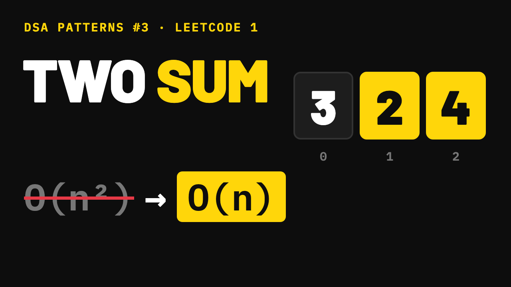

# Yellow template ("C")

The look chosen for DSA Patterns from part 3 on (2026-11-05): heavy white and yellow type on near-black, the
running example drawn as cells with the answer lit, and the complexity win as a badge. Used for the video
thumbnail, the Short's cover, and (as the `yellow` theme) the Short's frames and captions.

## Rules

- **Three elements, no more:** the title, one picture of the running example, the complexity badge. The series
  tag is small chrome, not an element.
- **Contrast:** yellow `#FFD60A` and white `#FFFFFF` on `#0D0D0D`. Yellow marks the one thing to look at: the
  second title word, the answer cells, the fast complexity. Red `#E63946` only strikes out the slow one.
- **Safe zones (1280×720):** nothing in the bottom-right 220×120 (YouTube's duration timer), nothing important
  in the bottom 60 px (the red progress bar). Keep the content in x 56–1220, y 40–600.
- **Legible at 320 px wide** (search results): check a 320×180 downscale before using it.
- **Never name the source** (book, chapter, section): the tag says the series and the problem number only.

## Tokens

| Token | Value | Use |
|---|---|---|
| ground | `#0D0D0D` | background |
| ink | `#FFFFFF` | title word 1, cell digits on dark cells |
| accent | `#FFD60A` | title word 2, lit cells (with `#0D0D0D` digits), the fast badge, the tag |
| dim | `#777777` | the slow complexity, index labels |
| strike | `#E63946`, 8 px | the line through the slow complexity |
| cell | `#1D1D1D` fill, `#333333` 4 px border, radius 18 | unlit cells |
| display | Barlow 900, uppercase, letter-spacing −0.02em | title (150 px), cell digits (120 px) |
| mono | IBM Plex Mono 600 | tag (30 px, +0.1em), badge (92 px), index labels (30 px) |

## Layout (1280×720)

| Element | Box |
|---|---|
| tag `DSA PATTERNS #N · LEETCODE K` | left 60, top 48 |
| title, one line, two words (`TWO` white + `SUM` yellow) | left 56, top 130, 150 px |
| cells, 150×170, gap 16, answer cells lit | left 735, top 180 |
| index labels under the cells | left 735, top 372 |
| badge `O(n²) → O(n)` (slow dim + struck, fast on a yellow pill) | left 60, top 430 |

For a Short's cover (1080×1920), stack the same three elements centred in y 320–1300: title, cells, badge.

## Making one

1. Copy `thumbnail.html` into `<output>/thumbnail-src/` with the fonts it loads (`fonts/barlow-latin-900-normal.woff2`,
   `fonts/ibm-plex-mono-latin-600-normal.woff2`; staged by `chalk assets` in `~/.cache/chalk-youtube/assets/fonts`).
2. Change only the tag, the two title words, the cell values (from the running example in the source) and which
   cells are lit (the answer, from the example script's output), and the two complexities (from the source's table).
3. Render: `"/Applications/Google Chrome.app/Contents/MacOS/Google Chrome" --headless=new --disable-gpu --hide-scrollbars
   --window-size=1280,720 --screenshot=$PWD/thumbnail-c.png "file://$PWD/thumbnail.html"`.
4. Point `video.json` at it: `"thumbnail": { "image": "thumbnail-src/thumbnail-c.png" }`. Deliver then copies it to
   `thumbnail.png` and puts the old frame grab in `thumbnail-frame.png`.
5. For YouTube's Test & Compare, list up to three `{ "thumbnail", "title" }` pairs under `thumbnail.test_compare`.

## Frames and captions

`short.json` / `video.json` `"theme": "yellow"` sets framelib's `yellow` theme (accent `#FFD60A`, Barlow) and the
captions in `frames/themes/yellow-captions.css` (white words, the spoken word in yellow, no plate).
